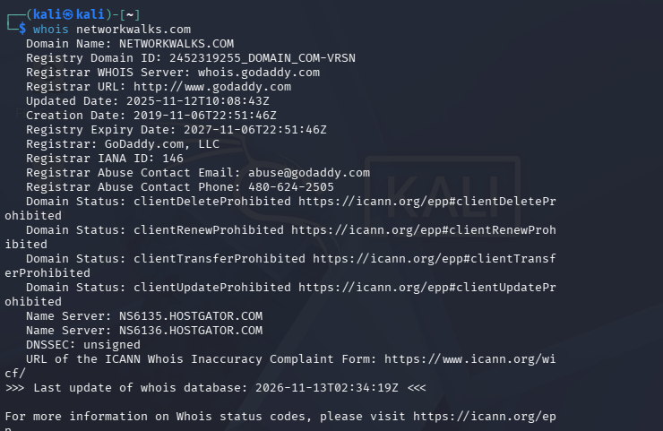
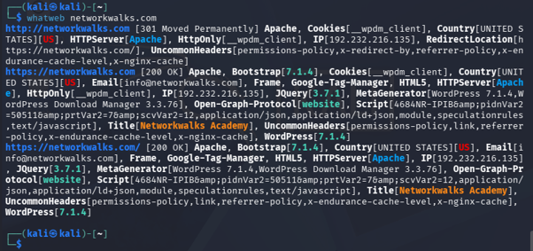
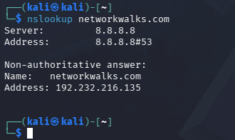
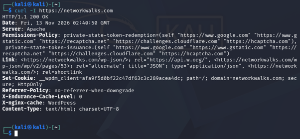
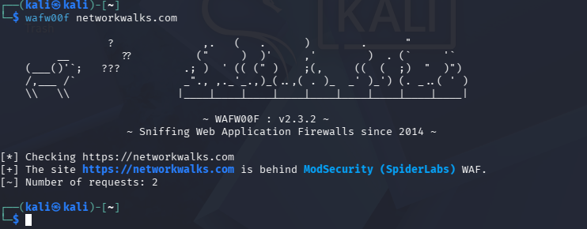
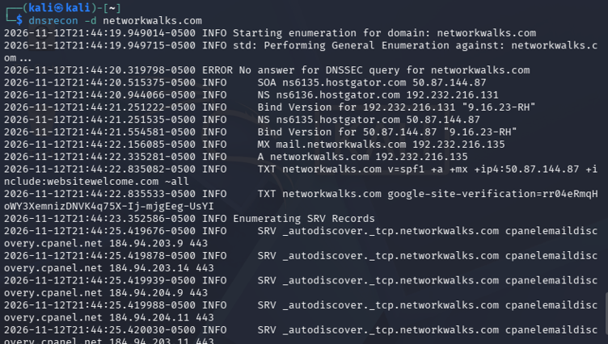
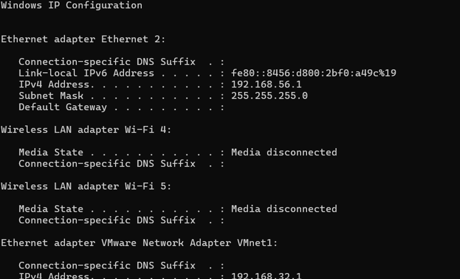
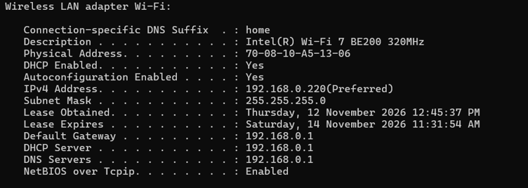
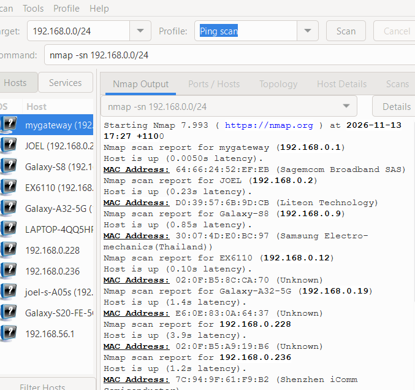
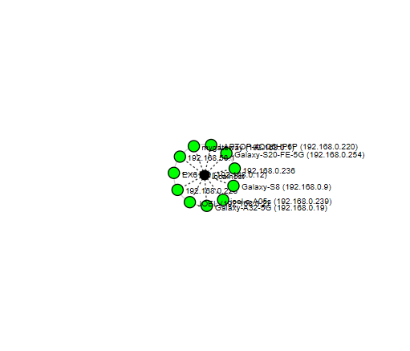

<div align="center">

# NETWORKWALKS-B084-WK2

This project involves conducting footprinting, reconnaissance and network scanning against an authorised domain and within a controlled local network environment.

</div>

## Project Information

| **Field** | **Detail** |
|---|---|
| **Pentester Name** | Joshua Kwon |
| **Program / Batch** | B084-Networkwalks |
| **Date** | 13 November 2026 |
| **Modules Completed** | W2-PM1 (Multiple Kali Tools)<br>W2-PM5 (Zenmap Scanning) |
| **Client / Target** | 1. Networkwalks (written permission secured)<br>2. My own local LAN network |
| **Permission Secured from Client?** | Yes |

# 1. Liability Disclaimer
This report was prepared as part of the NetworkWalks Cybersecurity Internship Program (B084) for educational and professional development purposes. Written authorisation was obtained prior to conducting the security assessments. All activities were performed within the authorised scope and were limited to footprinting, reconnaissance and network scanning.

No attempts were made to exploit vulnerabilities, disrupt services, bypass authentication or gain unauthorised access to systems. The findings are intended solely for educational and security awareness purposes and should not be interpreted as confirmed vulnerabilities unless supported by sufficient evidence.

# 2. Introduction

This report documents the activities completed during Week 2 of the NetworkWalks Cybersecurity Internship Program (B084). The exercises focused on footprinting and reconnaissance, alongside network scanning using Zenmap (W2-PM5).

The first activity involved gathering publicly available information about the authorised `networkwalks.com` domain using various Kali Linux utilities. This included WHOIS lookups, DNS enumeration, web technology fingerprinting, HTTP response header analysis and Web Application Firewall (WAF) detection. These techniques were used to examine domain registration information, identify associated network infrastructure and understand the technologies and security mechanisms protecting the target website.

The second activity focused on identifying active devices within my local network using Zenmap on Windows. This involved performing ping scans to discover responsive hosts and examining their associated IP addresses and available MAC address information. Windows Command Prompt utilities were also used to examine local network configuration.

The purpose of these exercises was to develop practical skills in information gathering, domain reconnaissance, network discovery and identifying potential security risks. Each activity is supported by relevant commands, observations, screenshots and explanations of the findings.

# 3. Tools Used

The following table outlines the tools and technologies used throughout the assessment and their respective purposes.

| **Tool** | **Purpose** |
| -------- | ----------- |
| Kali Linux | Operating system used to conduct domain footprinting and reconnaissance activities. |
| Windows 11 | Operating system used to perform local network discovery and examine network configurations. |
| WHOIS | Retrieves publicly available domain registration information, including registrar details, registration dates and name servers. |
| WhatWeb | Fingerprints websites to identify detectable technologies, web servers and frameworks. |
| nslookup | Performs DNS queries to resolve domain names into IP addresses and retrieve DNS information. |
| curl -I | Retrieves HTTP response headers to examine server responses and potentially disclosed configuration information. |
| Wafw00f | Identifies whether a website appears to be protected by a Web Application Firewall. |
| DNSRecon | Performs DNS enumeration to identify available records, including A, NS, MX, TXT and SRV records. |
| Zenmap (Nmap GUI) | Provides a graphical interface for Nmap and performs network discovery to identify responsive hosts, IP addresses and available MAC addresses. |
| Windows Command Prompt | Executes network configuration commands to identify local IP addresses, MAC addresses and network information. |

# 4. Activities Performed

## 4.1 Footprinting and Reconnaissance

The first activity involved conducting footprinting and reconnaissance against the authorised `networkwalks.com` domain using various Kali Linux utilities.

The objective was to gather publicly available information about the domain and examine its associated web infrastructure. Several tools were used to retrieve domain registration information, identify DNS records, fingerprint web technologies, analyse HTTP response headers and detect potential WAF protection.

### WHOIS Domain Lookup

The WHOIS utility was used to retrieve publicly available registration information associated with `networkwalks.com`.

The command was executed in Kali Linux:

```bash
whois networkwalks.com
```

The returned information was examined to identify relevant domain registration details, including registrar information, registration dates, domain status and name servers.

WHOIS lookups are useful during the initial stages of reconnaissance because they provide information about a domain's registration and administration. This information can help establish an initial understanding of the target's external presence and associated infrastructure.



### Web Technology Fingerprinting

WhatWeb was used to identify technologies associated with the target website.

The following command was executed:

```bash
whatweb networkwalks.com
```

WhatWeb examines website responses to identify detectable technologies, including web servers, content management systems, frameworks and other identifiable components.

The results were reviewed to establish what technologies could be identified through the website's publicly accessible responses.

Technology fingerprinting is useful during reconnaissance because it provides insight into the software and infrastructure supporting a website. This information may assist security professionals in identifying technologies that require ongoing maintenance, patching and security configuration.



### DNS Resolution

The `nslookup` utility was used to examine the DNS resolution of the target domain.

The following command was executed:

```bash
nslookup networkwalks.com
```

DNS translates human-readable domain names into IP addresses that computers use to communicate across networks.

The command returned the IP address associated with the domain, alongside information about the DNS resolver used to perform the query.

This information helps establish the network address associated with the target website and provides a foundation for further reconnaissance activities.



### HTTP Response Header Analysis

The `curl` utility was used to retrieve HTTP response headers from the target website.

The following command was executed:

```bash
curl -I https://networkwalks.com
```

The `-I` option instructs curl to retrieve the HTTP response headers without downloading the complete webpage content.

HTTP response headers contain metadata about the server's response, including status codes, content types, server information and potentially security-related configuration details.

The returned headers were examined to identify information disclosed by the web server and determine whether relevant HTTP security headers were present.

Examples of security-related headers include `Strict-Transport-Security`, `Content-Security-Policy` and `X-Content-Type-Options`. These headers can contribute to web application security when appropriately implemented.



### Web Application Firewall Detection

Wafw00f was used to determine whether a Web Application Firewall (WAF) could be identified protecting the target website.

The following command was executed:

```bash
wafw00f https://networkwalks.com
```

A Web Application Firewall is a security control designed to monitor and filter HTTP traffic between clients and web applications. It can help identify and mitigate malicious requests and common web application attacks.

Wafw00f examines website responses and compares identifiable characteristics against known WAF products and services.

The results were reviewed to determine whether the tool identified an existing WAF or returned an inconclusive detection result.

This activity provided additional insight into the security mechanisms that may be protecting the target website. However, an unsuccessful detection does not necessarily indicate that WAF protection is absent.



### DNS Enumeration

DNSRecon was used to conduct a broader examination of the DNS records associated with the target domain.

The following command was executed:

```bash
dnsrecon -d networkwalks.com
```

DNSRecon is a DNS enumeration utility that identifies publicly available DNS records and provides additional information about a domain's configuration.

The enumeration examined different DNS record types, including:

| **DNS Record** | **Purpose** |
| -------------- | ----------- |
| A | Maps a domain name to an IPv4 address. |
| AAAA | Maps a domain name to an IPv6 address. |
| NS | Identifies the authoritative name servers for a domain. |
| MX | Identifies mail servers responsible for receiving email. |
| TXT | Stores text-based DNS information, including SPF and domain verification records. |
| SOA | Contains administrative information about a DNS zone. |
| CNAME | Identifies an alias that points to another domain name. |
| SRV | Specifies the location and port of particular network services. |

The returned results were examined to identify available DNS information and understand the publicly identifiable infrastructure associated with the domain.

DNS enumeration is an important reconnaissance technique because publicly available DNS records can reveal information about an organisation's network architecture, email infrastructure and externally identifiable services.



## 4.2 Network Scanning with Zenmap

For the second activity, I used **Zenmap**, the graphical interface for Nmap, to perform network discovery and identify active devices on my local network. The objective was to identify the local network configuration, discover live hosts, collect their IP and MAC addresses, and generate a visual representation of the network topology.

I first used the Windows `ipconfig` command to identify my local IPv4 address, subnet mask and default gateway. Using this information, I determined the network range to scan.





I then opened Zenmap, entered the local subnet as the scan target and selected **Ping Scan** to perform host discovery. This scan allowed me to identify devices that were responding to network discovery probes without performing a detailed port or service scan.

The scan identified **11 live hosts, including my own computer**. The following IP addresses were discovered:

| **No.** | **IP Address** |
|:---:|:---|
| 1 | `192.168.0.1` |
| 2 | `192.168.0.2` |
| 3 | `192.168.0.9` |
| 4 | `192.168.0.12` |
| 5 | `192.168.0.19` |
| 6 | `192.168.0.228` |
| 7| `192.168.0.236` |
| 8 | `192.168.0.239` |
| 9 | `192.168.0.254` |
| 10 | `192.168.0.220` |
| 11 | `192.168.56.1` |



Zenmap also provided MAC address information for discovered devices where this information was available. This helped demonstrate how network scanning can be used to identify devices connected to a local network.

| **No.** | **MAC Address** |
|:---:|:---|
| 1 | `64:66:24:52:EF:EB` |
| 2 | `D0:39:57:6B:9D:CB` |
| 3 | `30:07:4D:E0:BC:97` |
| 4 | `02:0F:B5:8C:CA:70` |
| 5 | `E6:0E:83:0A:64:37` |
| 6 | `(Not Available)` |
| 7| `02:0F:B5:A9:19:B6` |
| 8 | `7C:94:9F:61:F9:B2` |
| 9 | `42:82:2F:CE:F2:0F` |
| 10 | `56:4E:B0:5A:A5:AD` |
| 11 | `72-08-10-A5-13-06` |

After completing the scan, I navigated to the **Topology** section in Zenmap, enabled the topology legend and generated a visual representation of the discovered network. I then saved the network topology as a PDF file, as required by the practical exercise.



# 5. Risk Analysis and Impact

Based on the information collected during the footprinting, reconnaissance and network scanning activities, I identified several potential security risks associated with publicly exposed infrastructure information and network visibility.

The following table summarises the findings, supporting observations and potential security implications.

| **#** | **Risk / Finding** | **Evidence / Observation** | **Potential Impact** | **Risk Level** |
|:---:|---|---|---|:---:|
| 1 | Web technology information exposed | WhatWeb identified WordPress and WP Download Manager. | Technology fingerprinting may help attackers identify software components and investigate potential vulnerabilities. | **Medium** |
| 2 | Server IP address identifiable | Nslookup resolved the target domain to `192.232.216.135`. | Provides information about the hosting infrastructure and assists further reconnaissance. | **Low** |
| 3 | HTTP technical information exposed | Curl returned HTTP response headers and identified the `/wp-json/` endpoint. | Response information and accessible endpoints may assist technology fingerprinting and further enumeration. | **Low** |
| 4 | WAF technology identifiable | Wafw00f identified ModSecurity (SpiderLabs). | Reveals information about the web application's security infrastructure and defensive technologies. | **Low** |
| 5 | DNS infrastructure information exposed | DNSRecon identified DNS, mail and service-related records. | Publicly available DNS information may help attackers map the organisation's infrastructure and identify additional services. | **Medium** |
| 6 | Multiple live hosts identified | Zenmap discovered 11 live hosts on the local network, including my own computer. | Unexpected or unauthorised devices could introduce additional attack surfaces if not properly managed. | **Medium** |

**Risk level key:**
● Critical ● Medium ● Low

The identified risks represent potential security concerns based on reconnaissance observations rather than confirmed vulnerabilities. The activities primarily involved passive information gathering, service identification and network host discovery. No exploitation or vulnerability validation was conducted during these exercises.

It is important to distinguish between information exposure and an actual security weakness. For example, identifying a web technology, server IP address or DNS record does not automatically indicate that the associated system is vulnerable. Additional authorised security testing would be necessary to establish whether these observations could be exploited.

---

# 6. Recommendations

Based on the findings from the footprinting and network scanning exercises, I identified the following security recommendations to help reduce information exposure and improve network visibility.

### 1. Review Publicly Exposed Technology Information

Organisations should periodically review publicly accessible information about their web technologies, content management systems (CMS) and installed plugins. Unnecessary technology disclosures should be minimised where practical.

### 2. Maintain Updated Software

CMS platforms, plugins, web servers and other software components should be regularly updated. Security advisories should also be monitored to identify and address known vulnerabilities.

### 3. Review HTTP Response Headers

HTTP response headers should be reviewed to identify unnecessary technical information that could assist attackers with technology fingerprinting. Security-related headers should also be configured appropriately.

### 4. Regularly Audit DNS Records

DNS records should be reviewed to ensure that only necessary information and services are publicly accessible. Unused records should be removed, and DNS configurations should be maintained accurately.

### 5. Configure and Monitor the Web Application Firewall

The Web Application Firewall (WAF), identified as ModSecurity during the reconnaissance exercise, should be properly configured, regularly updated and monitored. Its rules should be reviewed to ensure that malicious traffic is detected and blocked without unnecessarily affecting legitimate requests.

### 6. Perform Regular Internal Network Discovery

Organisations should periodically conduct authorised network discovery scans to identify active devices and maintain visibility over their internal network environment.

### 7. Investigate Unknown Network Devices

Unexpected devices identified during network scans should be investigated to determine their ownership, purpose and authorisation status. Unauthorised devices should be isolated or removed where necessary.

### 8. Maintain Accurate Network Documentation

Network topology diagrams, IP address allocations and device inventories should be maintained and updated regularly. Accurate documentation assists network administration, troubleshooting and security incident investigations.

### 9. Conduct Security Testing Within an Authorised Scope

Footprinting, reconnaissance and network scanning should only be performed against systems and networks for which appropriate authorisation has been obtained. Testing activities should remain within the approved scope and follow established security procedures.

---

# 7. Conclusion

During Week 2 of my **NetworkWalks Cybersecurity Internship Program (B084)**, I completed practical exercises covering footprinting, reconnaissance and network scanning using Kali Linux and Zenmap.

During the footprinting activity, I used six Kali Linux tools to collect information about a target domain. I learned how WHOIS can provide domain registration information, WhatWeb can identify web technologies, Nslookup can resolve domain names, Curl can inspect HTTP responses and headers, Wafw00f can identify Web Application Firewalls, and DNSRecon can retrieve DNS infrastructure information.

For the network scanning activity, I used Zenmap to examine my local network configuration and identify active devices. The scan discovered 11 live hosts, including my own computer. I also examined available IP and MAC address information and generated a network topology diagram to visualise the discovered devices.

These exercises demonstrated the importance of reconnaissance and information gathering in cybersecurity. Before attempting to identify or exploit vulnerabilities, security professionals need to understand the systems, technologies and network infrastructure within their assessment scope. Even seemingly minor details, such as DNS records, HTTP headers and active network devices, can contribute to a broader understanding of an environment's attack surface.

I also developed a better understanding of the importance of technical documentation and evidence-based risk assessment. Findings should be clearly recorded, their potential security implications explained, and recommendations provided to address identified concerns. It is equally important to distinguish between information gathered during reconnaissance and vulnerabilities that have been independently verified.

Overall, Week 2 provided practical experience with commonly used cybersecurity reconnaissance and network discovery tools. It strengthened my understanding of how information gathering contributes to identifying potential attack surfaces, assessing security risks and supporting subsequent security assessments.

All activities were performed as part of the assigned educational internship exercises and within the authorised testing environment.

## Resources

- [Oracle VirtualBox - Official Downloads](https://www.virtualbox.org/wiki/Downloads)
- [Kali Linux - Official Download Page](https://www.kali.org/get-kali/)
- [Zenmap - Official Download Page](https://nmap.org/zenmap/)

## Author Information

**Joshua Kwon**

Cybersecurity Intern | Networkwalks B084

[LinkedIn Profile](https://www.linkedin.com/in/joshua-kwon-05914337a/)

## Project Information
| Field | Details |
| ----- | ------- |
| Program Name | Cybersecurity at Networkwalks |
| Networkwalks ID | B084 |
| Week | 02 |
| Projects | FOOTPRINTING & RECONNAISSANCE ATTACKS WITH MULTIPLE KALI TOOLS and NETWORK SCANNING WITH ZENMAP |
| Project Reference | NETWORKWALKS-B084-WK2 |
